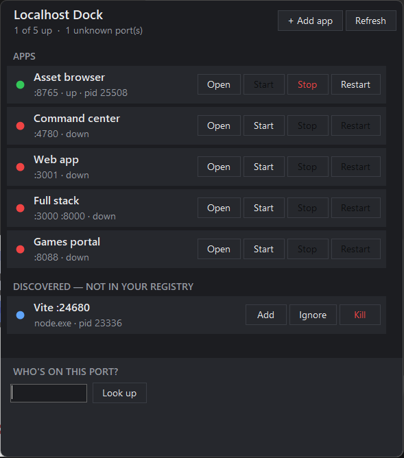

# Localhost Dock

A Windows tray widget for every local app and dev server you run: whether each one is up or down, and one-click control.

<p align="center"></p>

If you keep a handful of local tools running (an API on `:8765`, a dashboard on `:4780`, a Next.js app, some Vite server you forgot about), Localhost Dock puts them all one click from the tray:

- **A registry of your apps.** Each entry has a name, port, URL and start command.
- **A green or red dot per app,** plus **Open**, **Start**, **Stop** and **Restart**.
- **"Who's on this port?"** shows the process holding any port, with a confirmed **Kill**. It also tells you when Windows has *reserved* the port (Hyper-V/WSL/Docker), the usual reason a dev server fails with `EACCES` on a port where nothing is listening.
- **Auto-discovery.** Unknown listening ports (say, a stray Vite on `:5173`) show up under *Discovered*, with **Add**, **Ignore** and **Kill**.
- **Reuses your existing launchers.** Point an app at your `Start-Whatever.cmd` (and optionally `Stop-Whatever.cmd`) and it runs exactly as it does when you double-click it. Nothing gets replaced or rewritten.

It's a single small .NET 8 WinForms executable. It has no background service, needs no admin rights and sends nothing over the network.

## Install

**Requirements:** Windows 10/11 and the [.NET 8 Desktop Runtime](https://dotnet.microsoft.com/download/dotnet/8.0) (the SDK too, if you build from source).

### From a release

1. Download `LocalhostDock-<version>-win-x64.zip` from [Releases](../../releases).
2. Unzip it anywhere and run `LocalhostDock.exe`.
3. Right-click the tray icon and tick **Start with Windows** if you want it at login.

### From source

```powershell
git clone https://github.com/kumarnabh/localhost-dock.git
cd localhost-dock
.\install.ps1            # publishes to %LOCALAPPDATA%\Programs\LocalhostDock, adds a Start Menu shortcut, starts it
```

`.\install.ps1 -Uninstall` removes it again. Your `apps.json` is always left alone.

## Using it

| Action | How |
| --- | --- |
| Open / close the dock | Left-click the tray icon (<kbd>Esc</kbd> or clicking away also closes it) |
| Open, Start, Stop, Restart | Buttons on each app row. Buttons that don't apply right now are greyed out |
| Edit or remove an app | Right-click the app row |
| Add an app | **+ Add app**, or **Add** on a discovered port (pre-fills name, port and command line) |
| Hide a discovered port for good | **Ignore** (stored in `ignoredPorts`) |
| Find out who holds a port | Type the port under *Who's on this port?* and press <kbd>Enter</kbd> |
| Edit the registry by hand | Tray menu → **Edit apps.json**, then **Reload apps.json** |
| Start at login | Tray menu → **Start with Windows** |

The tray icon's dot sums things up: **green** means every configured app is up, **amber** means some are, **grey** means none. Hover over the icon for the count.

### What the dot means

| Dot | State |
| --- | --- |
| 🟢 | Something is listening on the app's `port` |
| 🔴 | Nothing is listening on it |
| 🟠 | Starting or stopping: you clicked Start/Stop and the port hasn't changed yet (gives up after 90 s / 30 s) |
| ⚪ | No `port` configured, so status can't be known |
| 🔵 | A discovered port that isn't in your registry |

Status comes from the OS TCP listener table, polled every 2 seconds by default. Nothing makes HTTP requests to your apps.

## Configuration

On first run, Localhost Dock creates `%APPDATA%\LocalhostDock\apps.json` from [`apps.example.json`](apps.example.json). It's plain JSON, and comments and trailing commas are allowed:

```jsonc
{
  "apps": [
    {
      "name": "Asset library",
      "port": 8765,
      "start": "C:\\dev\\assets\\Start-Assets.cmd",   // your existing launcher
      "stop":  "C:\\dev\\assets\\Stop-Assets.cmd"     // optional
    },
    {
      "name": "Web",
      "port": 5173,
      "start": "npm run dev",
      "cwd": "C:\\dev\\web"
    }
  ],
  "ignoredPorts": [],
  "pollMs": 2000
}
```

Every field, and exactly how Start and Stop behave, is covered in **[docs/CONFIGURATION.md](docs/CONFIGURATION.md)**.

## Safety

- **Kill always asks first.** The confirmation shows the process name, PID, port and full command line, and defaults to *No*.
- Kill ends the process **and its children** (`taskkill /T /F`), so an `npm run dev` doesn't leave an orphaned `node.exe` behind.
- System processes (`System`, `svchost.exe`, `lsass.exe`, `services.exe`, …) and Localhost Dock itself can't be killed from the dock, and they never appear under *Discovered*.
- **Stop** on a registered app runs your `stop` command if you set one. If there isn't one, or the port is still held 5 seconds after it finishes, Stop kills whatever is listening on the app's ports. That's the one place the dock kills without a second prompt, because the app row says exactly what it will stop.
- Your registry stays on your machine. Localhost Dock makes no network calls.

## Docs

- [Configuration reference](docs/CONFIGURATION.md)
- [How it works](docs/ARCHITECTURE.md)
- [Troubleshooting](docs/TROUBLESHOOTING.md)
- [Roadmap](ROADMAP.md) · [Changelog](CHANGELOG.md) · [Contributing](CONTRIBUTING.md) · [Security](SECURITY.md)

## Roadmap

Next up: **start groups** (e.g. "Shop dev" = API + web + worker started together), a **live log tail** per app, and a **crash toast** when an app that was up goes down without you stopping it. Details are in [ROADMAP.md](ROADMAP.md).

## License

[MIT](LICENSE)
