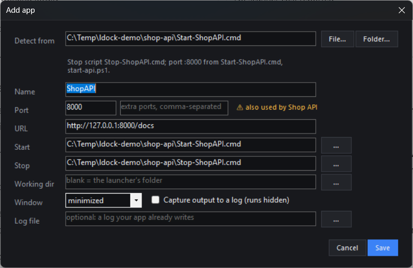

# Localhost Dock

A Windows tray widget for every local app and dev server you run: whether each one is up or down, and one-click control.

<p align="center"></p>

If you keep a handful of local tools running (an API on `:8765`, a dashboard on `:4780`, a Next.js monorepo, a Vite server you forgot about), Localhost Dock puts them all one click from the tray. A global shortcut (<kbd>Ctrl</kbd>+<kbd>Alt</kbd>+<kbd>L</kbd>) opens it too.

## Adding apps takes seconds

You don't have to write config. Give Localhost Dock a launcher or a project folder, and it works out the name, port, URL, start/stop commands and working directory:

| Do this | What happens |
| --- | --- |
| **Drag** a `Start-Something.cmd`, `.bat`, `.ps1` or a project folder onto the dock | The Add dialog opens already filled in. Check it and press <kbd>Enter</kbd> |
| **+ Add → Scan a folder for apps…** and pick e.g. `C:\dev` | Every launcher and dev script up to 3 levels deep, as a checklist. Tick, rename, import |
| Click **Add** on a *Discovered* port | Traces the running process back to its project (e.g. `node …\my-app\node_modules\vite\…` → `my-app`, `npm run dev`) |
| Right-click a folder or `.cmd` in **Explorer → Add to Localhost Dock** | Same as dropping it (turn on in tray menu → *Settings*) |
| `LocalhostDock.exe --add "C:\path\to\launcher-or-folder"` | Same, from a script. Works whether the dock is running or not |

<p align="center"></p>

**How detection works:**
- **Launchers** (`.cmd`, `.bat`, `.ps1`): it reads the launcher *and the scripts it calls* (`%~dp0scripts\start.ps1`, `$PSScriptRoot\…`) for ports (`--port 8000`, `$Port = 8765`, `-p 3001`, `http://127.0.0.1:4780`, …). It also finds a matching stop script (`Start-X.cmd` → `Stop-X.cmd`, `X-Start.ps1` → `X-Stop.ps1`).
- **Node projects:** it picks the `dev` / `start` / `serve` / `preview` script and follows it into the files it runs, `vite.config.*`, or the framework default (Next 3000, Vite 5173, Astro 4321, Angular 4200, …). It uses `npm`, `pnpm`, `yarn` or `bun` to match your lockfile.
- **Monorepos:** each `dev:<name>` script becomes its own app, with the port read from the workspace it runs (`npm run dev -w apps/web` → `apps/web/package.json`).
- **Django** (`manage.py`) and plain `python -m http.server` / `uvicorn` scripts are recognised too.

It only suggests. Every field stays editable, and the dialog warns you when a port is already used by another app, held by a running process, or reserved by Windows.

## Everything it does

**Status and control**
- A green, red or amber dot per app, plus **uptime and memory** (`:8765 · up 2h 14m · 142 MB`).
- Icon buttons for **Open**, **Start**, **Stop** and **Restart**. Hover any of them for a label. Double-click a row to open it.
- **⋯ menu** per app: *View logs*, *Copy URL*, *Open folder*, *Open in VS Code*, *Open terminal here*, *Add to group*, *Move up/down*, *Edit*, *Duplicate*, *Remove*.
- **Search box:** type to filter, then <kbd>Enter</kbd> opens the first match. <kbd>Ctrl</kbd>+<kbd>N</kbd> adds an app, <kbd>Esc</kbd> closes.
- **Tray right-click menu:** start, stop, restart or open any app or group without opening the dock.

**Start groups.** "Shop dev" = API + web + worker. **Start all** brings them up in order, waiting for each one's port before starting the next. **Stop all** stops them in reverse order.

**Notifications.**
- **Crash toast** when an app goes down without you stopping it. Click it to restart.
- **Didn't start** when nothing came up within 90 s. Click it to view the logs.
- **Is up** when a start finishes. Click it to open the app.

You can switch to crashes-only, or turn them off, in tray menu → *Settings*.

**Live logs.** Tick *Capture output to a log* on an app and Localhost Dock records everything its start command prints. **View logs** then shows a live tail with follow, clear and open-file. You can also point an app at a log file it already writes.

**Who's on this port?** Shows the process holding any port, with a confirmed **Kill**. When nothing is listening, it also tells you if Windows has *reserved* the port (Hyper-V/WSL/Docker), the usual reason a dev server fails with `EACCES`.

**Discovery.** Unknown listening ports (a stray Vite, an old Python server) show up under *Discovered*, with **Add**, **Ignore** and **Kill**.

**Your launchers stay yours.** Localhost Dock runs your existing `.cmd` files exactly as a double-click would, and never edits them.

It's a single small .NET 8 WinForms executable. It has no background service, needs no admin rights and sends nothing over the network.

## Install

**Requirements:** Windows 10/11 and the [.NET 8 Desktop Runtime](https://dotnet.microsoft.com/download/dotnet/8.0) (the SDK too, if you build from source).

### From a release

1. Download `LocalhostDock-<version>-win-x64.zip` from [Releases](../../releases).
2. Unzip it anywhere and run `LocalhostDock.exe`.
3. Optionally, right-click the tray icon → *Settings* and tick **Start with Windows** and **Explorer right-click: "Add to Localhost Dock"**.

### From source

```powershell
git clone https://github.com/kumarnabh/localhost-dock.git
cd localhost-dock
.\install.ps1            # publishes to %LOCALAPPDATA%\Programs\LocalhostDock, adds a Start Menu shortcut, starts it
```

`.\install.ps1 -Uninstall` removes it again, including the autostart and Explorer entries. Your `apps.json` is always left alone.

## Quick reference

| Action | How |
| --- | --- |
| Open / close the dock | Left-click the tray icon, or <kbd>Ctrl</kbd>+<kbd>Alt</kbd>+<kbd>L</kbd> (<kbd>Esc</kbd> or clicking away closes it) |
| Find an app | Just type; <kbd>Enter</kbd> opens the first match |
| Add an app | Drop a launcher/folder on the dock, **+ Add**, <kbd>Ctrl</kbd>+<kbd>N</kbd>, or **Add** on a discovered port |
| Add many apps | **+ Add → Scan a folder for apps…** |
| Edit, logs, folder, VS Code, groups | The **⋯** button (or right-click) on a row |
| Make a group | **+ Add → New group…**, or **⋯ → Add to group → New group…** |
| Find who holds a port | *Who's on port* at the bottom; <kbd>Enter</kbd> |
| Quick control from the tray | Right-click the tray icon |
| Settings | Tray menu → *Settings* (autostart, Explorer menu, notifications) |

### What the dot means

| Dot | State |
| --- | --- |
| 🟢 | Something is listening on the app's `port` |
| 🔴 | Nothing is listening on it |
| 🟠 | Starting or stopping: you clicked Start/Stop and the port hasn't changed yet (gives up after 90 s / 30 s) |
| ⚪ | No `port` configured, so status can't be known |
| 🔵 | A discovered port that isn't in your dock |

For groups, a filled dot means all members are up, a ring means some are, and red means none are.

Status comes from the OS TCP listener table, polled every 2 seconds by default. Nothing makes HTTP requests to your apps.

## Configuration

Everything lives in `%APPDATA%\LocalhostDock\apps.json`, and the dock edits it for you. If you prefer editing by hand (tray menu → *Edit apps.json*, then *Reload apps.json*), it looks like this:

```jsonc
{
  "apps": [
    { "name": "Asset library", "port": 8765, "start": "C:\\dev\\assets\\Start-Assets.cmd", "stop": "C:\\dev\\assets\\Stop-Assets.cmd" },
    { "name": "Web", "port": 5280, "start": "npm run dev", "cwd": "C:\\dev\\web", "captureLogs": true }
  ],
  "groups": [ { "name": "Shop dev", "apps": ["Asset library", "Web"] } ],
  "hotkey": "Ctrl+Alt+L",
  "notifications": "all"
}
```

Every field, and exactly how Start and Stop behave, is covered in **[docs/CONFIGURATION.md](docs/CONFIGURATION.md)**.

## Safety

- **Kill always asks first.** The confirmation shows the process name, PID, port and full command line, and defaults to *No*.
- Kill ends the process **and its children** (`taskkill /T /F`), so an `npm run dev` doesn't leave an orphaned `node.exe` behind.
- System processes (`System`, `svchost.exe`, `lsass.exe`, `services.exe`, …) and Localhost Dock itself can't be killed from the dock, and never appear under *Discovered*.
- **Stop** on a registered app runs your `stop` command if you set one. If there isn't one, or the port is still held 5 seconds after it finishes, Stop kills whatever is listening on the app's ports, plus the console the dock started. That's the one place the dock kills without a second prompt, because the app row says exactly what it will stop.
- Detection only *reads* your files. Nothing is saved until you press Save or Add.
- Your registry and logs stay on your machine. Localhost Dock makes no network calls.

## Docs

- [Configuration reference](docs/CONFIGURATION.md)
- [How it works](docs/ARCHITECTURE.md)
- [Troubleshooting](docs/TROUBLESHOOTING.md)
- [Roadmap](ROADMAP.md) · [Changelog](CHANGELOG.md) · [Contributing](CONTRIBUTING.md) · [Security](SECURITY.md)

## License

[MIT](LICENSE)
