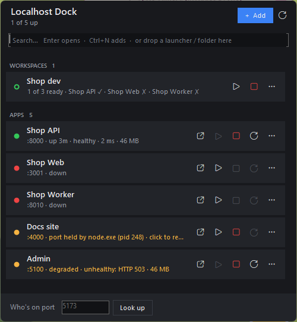
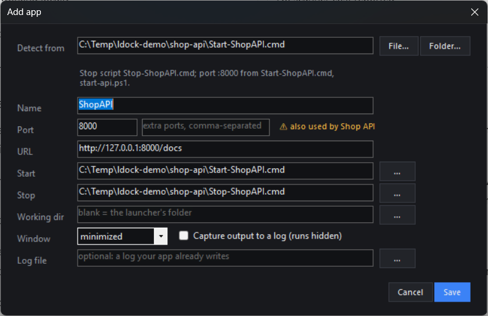
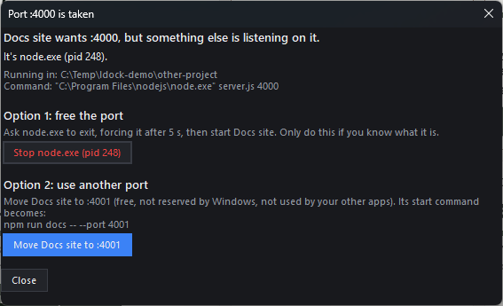

# Localhost Dock

A Windows tray widget for every local app and dev server you run: whether each one is up or down, and one-click control.

<p align="center"></p>

If you keep a handful of local tools running (an API on `:8765`, a dashboard on `:4780`, a Next.js monorepo, a Vite server you forgot about), Localhost Dock puts them all one click from the tray. A global shortcut (<kbd>Ctrl</kbd>+<kbd>Alt</kbd>+<kbd>L</kbd>) opens it too.

## Adding apps takes seconds

You don't have to write config. Give Localhost Dock a launcher or a project folder, and it works out the name, port, URL, start/stop commands and working directory:

| Do this | What happens |
| --- | --- |
| **Drag** a `Start-Something.cmd`, `.bat`, `.ps1` or a project folder onto the dock | The Add dialog opens already filled in. Check it and press <kbd>Enter</kbd> |
| **+ Add → Scan a folder for apps…** and pick e.g. `C:\dev` | Every launcher and dev script up to 3 levels deep, as a checklist. Tick, rename, import |
| Click **Add** on a *Discovered* port | Traces the running process back to its project (e.g. `node …\my-app\node_modules\vite\…` → `my-app`, `npm run dev`) |
| Right-click a folder or `.cmd` in **Explorer → Add to Localhost Dock** | Same as dropping it (turn on in tray menu → *Settings*) |
| `LocalhostDock.exe --add "C:\path\to\launcher-or-folder"` | Same, from a script. Works whether the dock is running or not |

<p align="center"></p>

**How detection works:**
- **Launchers** (`.cmd`, `.bat`, `.ps1`): it reads the launcher *and the scripts it calls* (`%~dp0scripts\start.ps1`, `$PSScriptRoot\…`) for ports (`--port 8000`, `$Port = 8765`, `-p 3001`, `http://127.0.0.1:4780`, …). It also finds a matching stop script (`Start-X.cmd` → `Stop-X.cmd`, `X-Start.ps1` → `X-Stop.ps1`).
- **Node projects:** it picks the `dev` / `start` / `serve` / `preview` script and follows it into the files it runs, `vite.config.*`, or the framework default (Next 3000, Vite 5173, Astro 4321, Angular 4200, …). It uses `npm`, `pnpm`, `yarn` or `bun` to match your lockfile.
- **Monorepos:** each `dev:<name>` script becomes its own app, with the port read from the workspace it runs (`npm run dev -w apps/web` → `apps/web/package.json`).
- **Other frameworks:** FastAPI (`uvicorn`, using your `.venv` if there is one), Flask, Django (`manage.py`), ASP.NET Core (port from `launchSettings.json`), Spring Boot (`mvnw`/`gradlew`, port from `application.properties`), Rails and Laravel.

It only suggests. Every field stays editable, and the dialog warns you when a port is already used by another app, held by a running process, or reserved by Windows.

## Everything it does

**Status and control**
- A green, red or amber dot per app, plus **uptime and memory** (`:8765 · up 2h 14m · 142 MB`).
- Icon buttons for **Open**, **Start**, **Stop** and **Restart**. Hover any of them for a label. Double-click a row to open it.
- **⋯ menu** per app: *View logs*, *Copy URL*, *Open folder*, *Open in VS Code*, *Open terminal here*, *Add to workspace*, *Move up/down*, *Edit*, *Duplicate*, *Remove* (plus *Resolve port conflict* when there is one).
- **Search box:** type to filter, then <kbd>Enter</kbd> opens the first match. <kbd>Ctrl</kbd>+<kbd>N</kbd> adds an app, <kbd>Esc</kbd> closes.
- **Tray right-click menu:** start, stop, restart or open any app or workspace without opening the dock.

**Workspaces.** "Shop dev" = API + web + worker, started with one click.
- Say what each app needs first (Web needs API, Worker needs API). **Start** brings the API up, waits until it's *ready*, then starts Web and Worker *together*. You can limit how many start at once.
- If a member fails, nothing that depends on it starts. You choose whether the rest carries on or everything stops.
- **Stop** goes in reverse, one app at a time. The workspace row shows each member's readiness (`API ✓ · Web … · Worker ✗`), and a toast tells you which member was slowest to become ready.

**Health checks.** Give an app a health URL (`/healthz`) and "running" starts to mean *healthy*, not just "something is listening":
- Workspace dependencies wait for health.
- An app whose checks fail turns **degraded**, with a toast and the HTTP status.
- The row shows latency (`healthy · 3 ms`).
- Checks only ever go to this machine.

**Port conflicts, solved.** When an app's port is taken, its row says by what. Click it (or press Start) for a wizard that shows the program and its folder, and offers to:
- **Stop it** safely, or stop the other app it belongs to;
- **Move this app** to a suggested free port. Any explicit `--port`/`-p` in its start command is rewritten for you.

<p align="center"></p>

**Session restore.** After a reboot or crash, the dock offers to start again the apps that were running. It respects workspace dependencies and never touches what's already up. You can make it automatic, or turn it off.

**`ldock` command line.** Read-only, machine-readable status for scripts and AI coding agents: `ldock status --json`, `ldock who 5173`, and `ldock manifest` (with secrets redacted). See [docs/CLI.md](docs/CLI.md).

**Notifications.**
- **Crash toast** when an app goes down without you stopping it. Click it to restart.
- **Didn't start** when nothing came up within 90 s. Click it to view the logs.
- **Is up** when a start finishes (with how long it took). Click it to open the app, or set *Open in the browser once it's ready* on the app.
- **Unhealthy / healthy again** when a health check starts failing or recovers.
- **Port taken** when another program grabs an app's port.

You can switch to crashes-only, or turn them off, in tray menu → *Settings*.

**Live logs.** Tick *Capture output to a log* on an app and Localhost Dock records everything its start command prints. **View logs** then shows a live tail with follow, clear and open-file. You can also point an app at a log file it already writes.

**Who's on this port?** Shows the process holding any port, with a confirmed **Kill**. When nothing is listening, it also tells you if Windows has *reserved* the port (Hyper-V/WSL/Docker), the usual reason a dev server fails with `EACCES`.

**Discovery.** Unknown listening ports (a stray Vite, an old Python server) show up under *Discovered*, with **Add**, **Ignore** and **Kill**.

**Your launchers stay yours.** Localhost Dock runs your existing `.cmd` files exactly as a double-click would, and never edits them.

It's a small .NET 10 WinForms app plus the `ldock` CLI. It has no background service, needs no admin rights and sends nothing over the network.

## Install

**Requirements:** Windows 10/11 (x64). The *self-contained* download needs nothing else; the smaller one needs the [.NET 10 Desktop Runtime](https://dotnet.microsoft.com/download/dotnet/10.0). Building from source needs the .NET 10 SDK.

### From a release

1. Download `LocalhostDock-<version>-win-x64-selfcontained.zip` (or the smaller `-win-x64.zip` if you have the .NET 10 Desktop Runtime) from [Releases](../../releases). `SHA256SUMS.txt` lists the hashes, so you can check the download with `Get-FileHash`.
2. Unzip it anywhere and run `LocalhostDock.exe`.
3. Optionally, right-click the tray icon → *Settings* and tick **Start with Windows** and **Explorer right-click: "Add to Localhost Dock"**.

### From source

```powershell
git clone https://github.com/kumarnabh/localhost-dock.git
cd localhost-dock
.\install.ps1            # build → self-test → swap in → start; rolls back automatically if the new version won't run
```

Upgrading is safe to run over a working install. The new build is staged and self-tested *before* the running dock is stopped. The previous version is kept, and it comes back automatically if the new one doesn't stay up (or run `.\install.ps1 -Rollback` yourself). Other switches: `-SelfContained` bundles the runtime, and `-Uninstall` removes everything including the autostart and Explorer entries. Your `apps.json` is never touched.

## Quick reference

| Action | How |
| --- | --- |
| Open / close the dock | Left-click the tray icon, or <kbd>Ctrl</kbd>+<kbd>Alt</kbd>+<kbd>L</kbd> (<kbd>Esc</kbd> or clicking away closes it) |
| Find an app | Just type; <kbd>Enter</kbd> opens the first match |
| Add an app | Drop a launcher/folder on the dock, **+ Add**, <kbd>Ctrl</kbd>+<kbd>N</kbd>, or **Add** on a discovered port |
| Add many apps | **+ Add → Scan a folder for apps…** |
| Edit, logs, folder, VS Code, workspaces | The **⋯** button (or right-click) on a row |
| Make a workspace | **+ Add → New workspace…**, or **⋯ → Add to workspace → New workspace…**; set dependencies in its editor |
| Fix a port conflict | Click the app's orange "port held by…" line, or press Start |
| Status from a script / agent | `ldock status --json` (see [docs/CLI.md](docs/CLI.md)) |
| Find who holds a port | *Who's on port* at the bottom; <kbd>Enter</kbd> |
| Quick control from the tray | Right-click the tray icon |
| Settings | Tray menu → *Settings* (autostart, Explorer menu, notifications, session restore) |

### What the dot means

| Dot | State |
| --- | --- |
| 🟢 | The app's own process is listening on its `port` (started by the dock, or running from the app's folder). *“owner unverified”* means something is listening but its details can't be read |
| 🔴 | Not running. The subtitle says *crashed (exit code N)* or *failed: …* when it didn't go down by your hand |
| 🟠 | **Degraded:** running, but its health check is failing (the subtitle shows the HTTP status) |
| 🟠 | **Port conflict:** another program holds the app's port. The subtitle names it; click it to resolve |
| 🟠 | Starting or stopping (subtitle says so): waiting for the port to open or close (start gives up after `startTimeoutSec`, 90 s by default) |
| ⚪ | No `port` configured, so status can't be known |
| 🔵 | A discovered port that isn't in your dock |

For workspaces, a filled dot means every member is ready, a ring means some are, and red means none are. Orange means one of them has a problem.

Status comes from the OS TCP listener table, polled every 2 seconds by default. The only HTTP requests are the health checks you configure, and those go to this machine only (localhost, 127.x, ::1).

## Configuration

Everything lives in `%APPDATA%\LocalhostDock\apps.json`, and the dock edits it for you. If you prefer editing by hand (tray menu → *Edit apps.json*, then *Reload apps.json*), it looks like this:

```jsonc
{
  "apps": [
    { "name": "Asset library", "port": 8765, "start": "C:\\dev\\assets\\Start-Assets.cmd", "stop": "C:\\dev\\assets\\Stop-Assets.cmd" },
    { "name": "Web", "port": 5280, "start": "npm run dev", "cwd": "C:\\dev\\web", "health": "/healthz", "openOnReady": true }
  ],
  "workspaces": [ { "name": "Shop dev", "apps": ["Asset library", "Web"], "dependsOn": { "Web": ["Asset library"] } } ],
  "hotkey": "Ctrl+Alt+L",
  "notifications": "all"
}
```

Every field, and exactly how Start and Stop behave, is covered in **[docs/CONFIGURATION.md](docs/CONFIGURATION.md)**.

## Safety

Stopping processes is the one dangerous thing this app does, so it's built around one rule: **never stop a process that isn't verifiably yours without asking.**

- **Stop only touches the app's own processes.** A process counts as the app's if the dock started it (a verified descendant of the launch), or if its working directory, command line or executable is inside the app's folder. Anything else on the port (another project, a different server) is *not* stopped. Instead you see what it is and why it doesn't look like this app, and you choose, with **No** as the default.
- **Every termination revalidates identity.** Processes are tracked by PID *and* creation time *and* executable path. Windows reuses PIDs, so a recycled PID never gets hit.
- **Graceful first.** The app is asked to exit (window close and Ctrl+C) and is force-stopped only after `gracefulTimeoutSec`. Set `stopPolicy: "graceful-only"` for apps that must never be force-killed. Child processes go too, so an `npm run dev` doesn't leave an orphaned `node.exe`.
- **Protected, always:** Windows system processes, services, Localhost Dock itself and the program that started it. They can't be stopped from the dock, even when Windows won't let it inspect them, and they never appear under *Discovered*.
- **Kill** (Who's on port / Discovered) always asks first, showing the process, PID, port and command line.
- **One operation at a time per app.** Restart only starts again once the stop is verified complete, and workspace stops go one app at a time, dependents first.
- **Your config is protected.** Edits made outside the dock are never overwritten. Every save keeps a backup, a corrupt `apps.json` is recovered from the newest good backup, and schema upgrades back up the original first.
- Detection only *reads* your files. Nothing is saved until you press Save or Add.
- Your registry and logs stay on your machine. Localhost Dock makes no network calls beyond your own health checks, which only reach this machine.
- The **conflict wizard** shows exactly what holds a port before offering to stop it, and its buttons ignore clicks for a moment after it appears, so a stray click can't choose for you.
- `ldock` is read-only: it can't start, stop or change anything.

These rules are covered by a dedicated safety test suite that CI runs before any release (see [docs/BACKLOG-STATUS.md](docs/BACKLOG-STATUS.md)).

## Docs

- [Configuration reference](docs/CONFIGURATION.md)
- [How it works](docs/ARCHITECTURE.md)
- [Troubleshooting](docs/TROUBLESHOOTING.md)
- [Command line (`ldock`)](docs/CLI.md)
- [Upgrade backlog status](docs/BACKLOG-STATUS.md)
- [Roadmap](ROADMAP.md) · [Changelog](CHANGELOG.md) · [Contributing](CONTRIBUTING.md) · [Security](SECURITY.md)

## License

[MIT](LICENSE)
